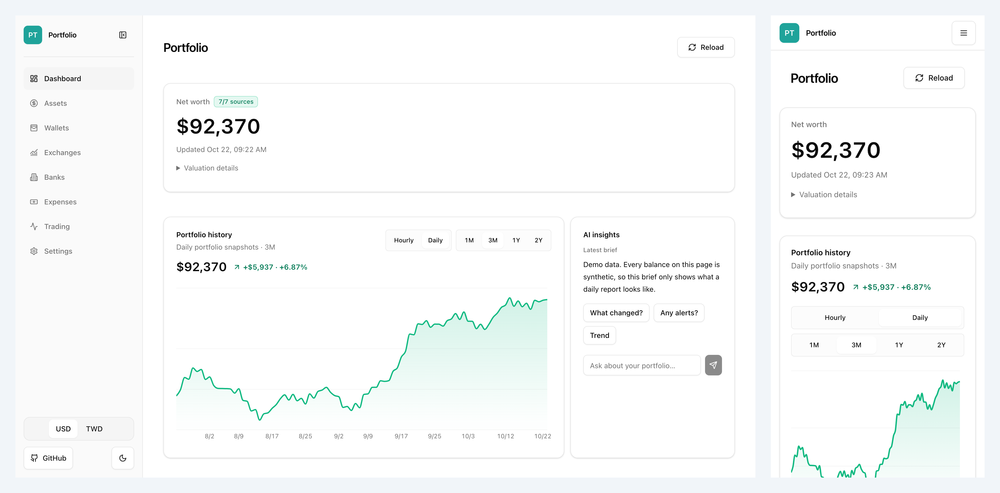
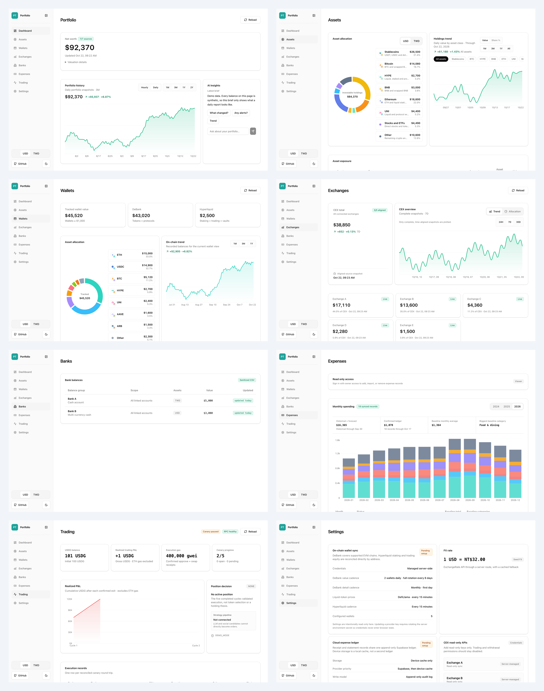
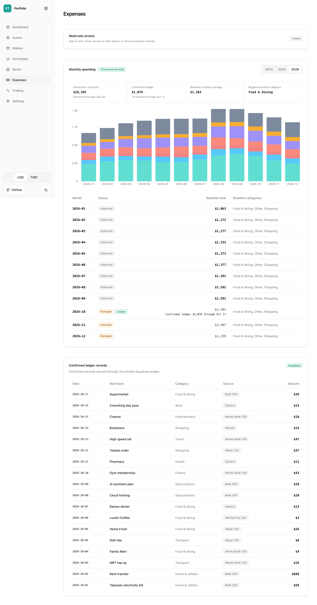
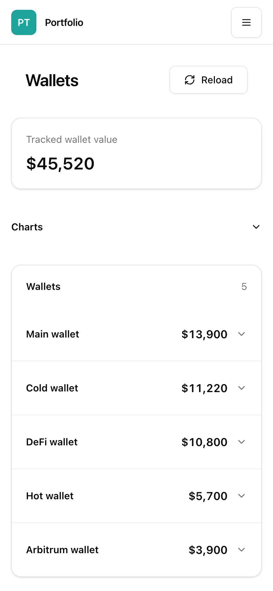
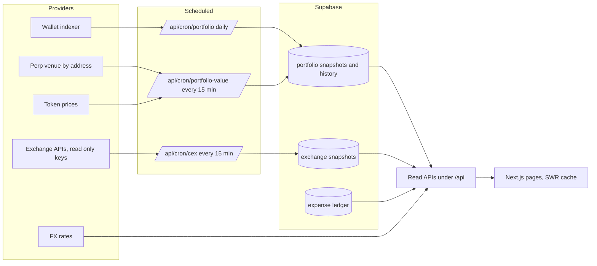

# Portfolio Tracker

One page that answers where the money is, what it is made of and how fresh each number is

**Live demo: https://portfolio-tracker-demo-gamma.vercel.app**

[Run it](#run-it) · [Set it up with an agent](#set-it-up-with-an-agent) · [Connect your own sources](#connect-your-own-sources) · [How it works](#how-it-works) · [Daily snapshots](docs/snapshots)



Every screenshot in this README comes from demo mode, which serves synthetic fixtures. The balances, wallets, banks and exchange accounts you see are invented, and the open source copy never contains a real one

The demo is shaped like a real spread: five exchanges, five wallets, Aave and Morpho deposits, a Hyperliquid vault, tokenized TSLA and SPCX on two exchanges, and the same USDT sitting in six places. That scatter is the problem this app exists for

## Why I built this

My money lives in too many places: a few exchanges, a handful of wallets on different chains, two banks, and a spreadsheet of monthly spending. Each app shows its own slice and none of them shows the sum. I wanted one number, and under it a plain answer to three questions: where is it held, what is it made of, and when was each part last updated

The first version was a weekend of seed JSON and eight pages. What kept it alive was the discipline around live data. Browser requests never call an exchange; a scheduled job does, writes a snapshot, and the page reads the snapshot. That split sounds obvious and it took a cost incident to learn it properly, when a wallet provider's credits were burned by refreshes nobody needed. Since then the sync modes are separate, there is a monthly budget with a hard stop, and partial data is shown as partial instead of being summed quietly

This public copy exists so the structure can be reused. The private deployment holds real keys and real balances and stays private, and a sync script keeps this repository as a filtered snapshot of it

## What it does



| Page | The question it answers |
| --- | --- |
| Dashboard | Net worth now, split by custody and by asset, with a freshness badge per source |
| Assets | Allocation across stablecoins, Bitcoin, Ethereum and the rest, with history per class |
| Wallets | Each wallet token by token and protocol by protocol, with a trend |
| Exchanges | Balance per exchange and account type from 15 minute snapshots |
| Banks | Cash in fiat, labeled as a preview until a real import is normalized |
| Expenses | Monthly spending by category, a forecast, and one ledger fed by bank CSV, Money Book, Alipay and WeChat Pay exports plus receipt photos |
| Trading | A read only record of what an automated trading canary actually executed |
| Settings | Which sources are connected, on what cadence, and whether they are healthy |





One currency toggle switches USD and TWD everywhere. Light and dark themes share the same tokens. On a phone every table scrolls inside its card so the page never scrolls sideways

## How it works



Sync is separated from reading. Every paid or rate limited provider call runs inside a cron route protected by a secret and fenced by a database lease, so two runs never overlap. Pages only read persisted snapshots, which is why a page load costs nothing and why a provider outage shows up as a stale badge instead of an error page

Demo mode sits at the same boundary. With `PORTFOLIO_DEMO_MODE=1` each read API returns a fixture from `lib/server/demo-fixtures.ts`, login is skipped, and no Supabase or provider key is needed. The fixtures go through the same components as real data, so what you see in the demo is what the app looks like

Stack: Next.js 15 App Router, React 18, TypeScript, Tailwind, Radix primitives, Recharts, SWR, Supabase with pg_cron, Vercel

## Run it

Node 24

```sh
git clone https://github.com/Hugo6991/portfolio-tracker.git
cd portfolio-tracker
npm install
PORTFOLIO_DEMO_MODE=1 npm run dev
```

Open http://localhost:3000. Every page works, every number is synthetic, and nothing leaves your machine

```sh
npm test              # vitest unit and route tests
npx tsc --noEmit
PORTFOLIO_DEMO_MODE=1 npm run build && PORTFOLIO_DEMO_MODE=1 npm start
```

## Set it up with an agent

Paste one of these into Claude Code, Codex or any coding agent that can run a shell. The agent asks about your currency, exchanges, wallets, banks and which agent should read the data first, then builds the dashboard step by step and shows you each result. You paste every API key into `.env.local` yourself, never into the chat

### English

```text
You are my engineering assistant. Help me set up my own portfolio dashboard from the open source repo https://github.com/Hugo6991/portfolio-tracker

Do not touch anything yet. Ask me the questions below one at a time, and start only after all of them are answered

1. Which display currency? USD and TWD are built in, anything else needs a change in lib/fx.ts
2. Which exchanges do you use? Binance, OKX, Bitget, HTX and Gate are built in, others need a new adapter
3. Which on-chain wallets? How many EVM and Hyperliquid addresses? Do you have a DeBank Pro API key?
4. Which currencies are your bank accounts in? Enter balances by hand, or import a CSV?
5. Do you want to track expenses? Is the source a bank, Alipay or WeChat CSV?
6. Which agent should read the data? Claude Code, Codex or something else? Should it see the total, or only percentages?
7. Run locally only, or deploy to Vercel with Supabase running scheduled syncs?

Then work in this order, and show me the result of each step before moving on

1. Clone the repo and run PORTFOLIO_DEMO_MODE=1 npm run dev on Node 24. Confirm the demo renders
2. Keep my copy private or local only. Real balances and addresses never go to a public GitHub repo
3. Apply my answers. Wallet addresses go into wallets in data/portfolio.json, bank balances into banks
4. List the .env.local fields and let me paste the API keys myself. Never ask me to paste a key into this chat. Exchange keys are read only, with trading and withdrawal disabled
5. Keep the repo's DeBank budget: 15 minute refreshes make zero DeBank calls, 2 wallets are sampled per day, a full scan runs once a month, and syncing pauses above 10,000 units a month. Estimate my monthly cost before enabling it
6. Clear TRADING_WORKER_BASE_URL or remove the Trading page. It points to the original author's trading bot
7. Set PORTFOLIO_VIEWER_PASSWORD and PORTFOLIO_VIEWER_SESSION_SECRET so the dashboard needs a password
8. If deploying, create a Supabase project, apply supabase/migrations/ in filename order, store the production URL and CRON_SECRET in Supabase Vault, deploy to Vercel, and confirm cron requests without the secret return 401
9. Agent access. Generate a random token, put its SHA-256 in AGENT_FINANCE_API_TOKEN_SHA256, and show me a curl call to /api/agent/finance with the Bearer token. Then add a short section to CLAUDE.md or AGENTS.md telling Claude Code and Codex where and how to read it. /api/agent/portfolio needs no login, so ask me whether it should stay public
10. Run npm test and npm run build, open the dashboard, and screenshot every page for me

Report honestly throughout: what you ran and saw working, and what you only configured without verifying
```

### 繁體中文

```text
你是我的工程助手，要幫我用開源專案 https://github.com/Hugo6991/portfolio-tracker 架一個自己的資產管理看板

先不要動手。下面的問題一次問一題，全部問完再開始

1. 看板要用什麼幣別顯示？目前內建 USD 和 TWD，其他幣別要改 lib/fx.ts
2. 你用哪些交易所？內建 Binance、OKX、Bitget、HTX、Gate，其他家要新增 adapter
3. 有哪些鏈上錢包？EVM 和 Hyperliquid 地址各幾個？有沒有 DeBank Pro API key？
4. 銀行帳戶有哪些幣別？要手動填餘額，還是匯入 CSV？
5. 支出要不要記？來源是銀行、支付寶還是微信的 CSV？
6. 要讓哪個 Agent 讀取？Claude Code、Codex 還是其他？要讓它看到總額，還是只看百分比？
7. 只在本機跑，還是部署到 Vercel 加 Supabase 定時同步？

問完照這個順序做，每一步做完給我看結果再往下

1. clone repo，用 Node 24 跑 PORTFOLIO_DEMO_MODE=1 npm run dev，先看 demo 畫面正常
2. 改成 private repo 或只留在本機，真實餘額和地址不能推到公開 GitHub
3. 依我的答案改設定，錢包地址寫進 data/portfolio.json 的 wallets，銀行餘額寫進 banks
4. 列出 .env.local 要填的欄位，讓我自己貼 API key，不要叫我把 key 貼在對話裡。交易所 key 只開讀取，不開交易和提現
5. DeBank 照 repo 的省錢設定，每 15 分鐘的更新不呼叫 DeBank，每天只抽 2 個錢包，每月完整掃一次，月用量超過 10,000 units 自動暫停。動手前先算給我看每月大概花多少
6. 清空 TRADING_WORKER_BASE_URL 或拿掉 Trading 頁，那是原作者自己的交易 bot
7. 設好 PORTFOLIO_VIEWER_PASSWORD 和 PORTFOLIO_VIEWER_SESSION_SECRET，看板要密碼才能看
8. 要部署的話，建 Supabase 專案，依檔名順序跑 supabase/migrations/，把網址和 CRON_SECRET 存進 Supabase Vault，部署到 Vercel，確認沒帶 secret 的 cron 請求回 401
9. Agent 接入。產生一組隨機 token，把它的 SHA-256 填進 AGENT_FINANCE_API_TOKEN_SHA256，示範用 curl 帶 Bearer token 讀 /api/agent/finance。再在 CLAUDE.md 或 AGENTS.md 寫一段說明，讓 Claude Code 和 Codex 知道去哪讀、怎麼讀。/api/agent/portfolio 不用登入就能讀，問我要不要保留公開
10. 跑 npm test 和 npm run build，打開看板截每一頁給我看

全程照實回報，哪些已經跑起來看過，哪些只是改了設定還沒驗證
```

## Connect your own sources

1. Create a Supabase project and apply `supabase/migrations/` in filename order
2. Copy `.env.example` to `.env.local`. Fill `SUPABASE_URL`, `SUPABASE_SERVICE_ROLE_KEY` and `CRON_SECRET`, then the read only API keys of the exchanges you use. Keys with trade or withdraw permission are never needed
3. Set `PORTFOLIO_VIEWER_PASSWORD` and `PORTFOLIO_VIEWER_SESSION_SECRET`. The dashboard asks for the viewer password once per browser
4. Leave `PORTFOLIO_DEMO_MODE` unset. Demo mode and real credentials must never be on at the same time
5. Deploy to Vercel, store the production URL and the cron secret in Supabase Vault, and let `pg_cron` call the protected routes on the cadences listed on the Settings page

Supported today: five exchanges through their public APIs, EVM wallets through a wallet indexer, Hyperliquid by address, token prices from DefiLlama, FX from ExchangeRate API. Adding an exchange means one adapter in `lib/server/cex-sources.ts` and one line in `lib/cex.ts`

## Data and privacy

| What | Where | In this repo |
| --- | --- | --- |
| Code, migrations, tests | `app`, `components`, `lib`, `supabase` | Yes |
| Demo balances and expenses | `data/portfolio.json`, `data/expenses.json`, generated by `scripts/make-demo-data.mjs` | Yes, synthetic |
| Demo API fixtures | `lib/server/demo-fixtures.ts` | Yes, synthetic |
| Real keys, balances, bank exports, receipts | the private deployment and its ignored `private-data/` | Never |

Provider credentials are server only and read only. Wallet addresses are shown compact in the UI and the public history API omits them. Bank data is an aggregate labeled preview. Cron routes answer 401 to anyone without the secret

This repository is produced by a script that copies an allow list of files from the private repo, regenerates the demo data, replaces every personal identifier, and refuses to push if a scan finds one. If you spot something that looks personal, open an issue and it comes out in the next sync

## Status

| Works today | Not here |
| --- | --- |
| Eight pages, demo mode, USD and TWD, light and dark, phone layout | A hosted multi user version |
| Five exchange adapters, wallet indexer, Hyperliquid, prices, FX | Bank APIs, so banks stay a CSV preview |
| Scheduled sync with leases, last known good fallback, cost budget | Write access of any kind to a venue |
| Expense ledger with CSV import (bank, Money Book, Alipay, WeChat Pay), receipt capture and forecast | Tax reports |

MIT License for the code. Exchange, wallet and price providers have their own terms

Built by one person with a team of agents. Product and design decisions are mine; agents write the code and I review what ships
